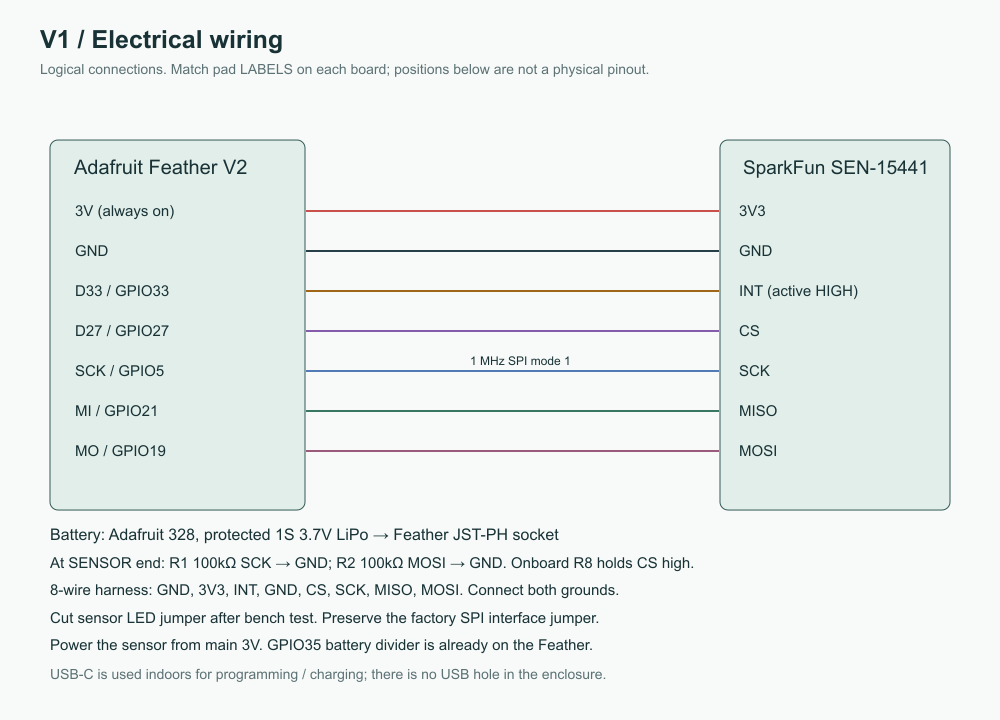
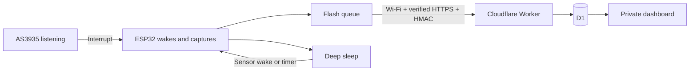

# Lightning detector

A battery-powered lightning observation station built with an **Adafruit Feather ESP32 V2** and a **SparkFun AS3935 SPI sensor**. It sends observations over Wi-Fi to a Cloudflare Worker and stores them in D1. A simple, private dashboard shows activity, estimated distance, station health, battery voltage, and a rough battery percentage.

This repository contains the source and build instructions for making your own station. Bring your own hardware, Wi-Fi credentials, and Cloudflare account; each replica has its own service and access tokens.

## What it does

- Keeps the AS3935 listening while the ESP32 sleeps; the sensor interrupt wakes the ESP32.
- Sends a health heartbeat every six hours and captured observations when activity occurs.
- Buffers up to 128 observations in a checksummed flash queue during network outages and retries later.
- Uses verified HTTPS and HMAC-signed ingestion, with a separate dashboard read token.
- Shows a 24-hour distance scatter plot, searchable event history, and JSON export in a cream/white dashboard.
- Remembers dashboard access in a trusted browser, with tab-only access and explicit sign-out available.

One sensor provides a statistical range estimate, **not a compass bearing or exact strike location**. This is a hobby instrument, not a certified lightning warning system. A quiet or offline detector does not establish that it is safe outdoors.

## Hardware

| Part | Requirement |
| --- | --- |
| Microcontroller | Adafruit Feather **ESP32 V2**, product 5400; this pinout is specific to V2 |
| Sensor | SparkFun **SEN-15441**, AS3935 SPI breakout, v20 |
| Power | Compatible protected **1S LiPo**, 3.7 V nominal / 4.2 V full; verify JST polarity |
| Harness | Eight-conductor stranded wire, two 100 kΩ pull-down resistors, insulation and strain relief |
| Programming | USB-C **data** cable and a computer |
| Network | 2.4 GHz Wi-Fi; no captive portal |
| Optional outdoor package | Hammond 1554R2GY enclosure, insulating carrier, vent, nylon hardware, foam, strap and desiccant |

The original enclosure layout uses a 2500 mAh pack. A separate **110 × 150 mm carrier for an EEMB LP103395 / 3700 mAh pack** is included. Choose a matching layout; the longer pack is not a drop-in replacement in the original carrier. See the [generic BOM](hardware/BOM.md), [mechanical guide](hardware/3d/README.md), and [power guide](docs/power.md).

### Wiring

Use the Feather's main **3V** pin so the sensor stays powered during deep sleep. The switched STEMMA/NeoPixel supply is unsuitable for continuous listening.

| Feather V2 | SparkFun sensor | Notes |
| --- | --- | --- |
| 3V | 3V3 | 3.3 V supply |
| GND | GND | Common ground; the eight-wire harness uses two ground returns |
| 33 | INT | Active-high interrupt / deep-sleep wake |
| 27 | CS | Chip select; breakout already has a 10 kΩ pull-up |
| SCK / GPIO5 | SCK | Add 100 kΩ from SCK to GND at the sensor |
| MI / GPIO21 | MISO | Sensor → Feather |
| MO / GPIO19 | MOSI | Add 100 kΩ from MOSI to GND at the sensor |



Match pad names rather than header order. Keep the sensor in its factory SPI configuration and leave optional I²C pull-up bridges open. Check continuity and shorts with power disconnected before using USB. The [build guide](docs/build.md) covers bench setup and enclosure assembly.

## Build your own

Commands below use **PowerShell**. On macOS/Linux, use `npm`/`npx` in place of `npm.cmd`/`npx.cmd` and your system's serial-device path.

### 1. Get the source and tools

Use Python 3.10+ and Node.js 22+:

```powershell
git clone https://github.com/T-Lind/lightning-detector.git
cd lightning-detector
python -m pip install platformio==6.1.19
npm.cmd ci --prefix cloudflare
npm.cmd test --prefix cloudflare
```

PlatformIO pins the ESP32 platform and sensor/JSON libraries. Firmware builds without credentials using inert example headers; it cannot upload observations until provisioned.

### 2. Prove and tune the sensor

```powershell
python -m platformio device list
python -m platformio run -d firmware -e bench -t upload --upload-port COM5
python -m platformio device monitor --port COM5 --baud 115200
```

Replace `COM5` with the port reported for your board. Expect `Sensor OK`; close the monitor before flashing again. Flash `tune`, measure antenna resonance in its final arrangement, and set `TUNING_PF` in `firmware/include/config.h` to your measured value. The committed `0 pF` is a **placeholder**, not a universal calibration. Never leave `tune` or a diagnostic image running as the detector. See [firmware setup](docs/firmware.md).

### 3. Create your cloud service

Follow [Cloudflare setup](docs/cloud-setup.md) to copy the config template, select your account, create D1, install its schema, and set **two different random secrets**. Deploy the Worker and confirm that the login page loads while unauthorized API reads are rejected.

The deployment template contains no real account, database, or station identifiers. Notifications are disabled by default; [future notification options](docs/notifications.md) are documented but not configured.

### 4. Provision and flash normal firmware

Copy `firmware/include/secrets.example.h` to `firmware/include/secrets.h`. Set your Wi-Fi, HTTPS Worker URL, device ID, and ingestion secret. Install a verified TLS root with `tools/install_ca.py`; keep certificate validation enabled.

For a **new device with no stored history**, initialize LittleFS once, then flash:

```powershell
python tools/format_littlefs.py
python -m platformio run -d firmware -e feather -t uploadfs --upload-port COM5
python -m platformio run -d firmware -e feather -t upload --upload-port COM5
python -m platformio device monitor --port COM5 --baud 115200
```

**`uploadfs` erases the queued observations. Do not run it during ordinary firmware upgrades.** Erasing NVS also resets sequence reservations and requires a new device identity or migration. Normal upgrades flash the application only. OTA is not implemented.

Check sensor/storage health, NTP, HTTPS upload acknowledgment and the first dashboard heartbeat. Finish the [commissioning checklist](docs/commissioning.md), including battery-powered interrupt wake and real sleep-current measurements.

## How it operates



The sensor remains powered; Wi-Fi, the Feather LED and switched peripheral rail are off during sleep. Quiet operation normally has four health uploads per day. Failed connections retry after 15 minutes; noisy/stuck interrupts can trigger a 60-second recovery interval. At an indicated 3.40 V or below, firmware defers Wi-Fi and preserves sensing where possible. See [design rationale](docs/design.md) and [firmware behavior](docs/firmware.md).

The SparkFun red power LED is wired directly to its supply. Software cannot turn it off. After initial tests, its **LED jumper trace** can be opened with both battery and USB disconnected; do not cut interface/address traces. Leaving it on materially increases sleep consumption. Battery lifetime is an estimate until complete-device current and transaction charge have been measured. The dashboard percentage is a voltage-based approximation and is affected by USB charging, load and temperature.

## Validation and limits

The prototype has passed USB bench checks for sensor register readback, RC calibration, antenna oscillator measurement, interrupt wiring and ESP32 wake, plus normal storage/network/HTTPS heartbeat operation. Automated tests cover backend semantics and dashboard models/access behavior. See [validation](docs/validation.md) for the public test record and reproducible commands.

Real lightning sensitivity, range accuracy, capture completeness, final enclosure fit/sealing and measured battery lifetime still require physical and field testing. The AS3935 does not offer a full event FIFO; closely spaced events or activity during host processing can be missed or coalesced. Fault/overdue states and untimed observations remain explicit in the dashboard. Range/energy values are estimates and raw sensor data, respectively.

## Repository guide

| Path | Contents |
| --- | --- |
| [firmware](firmware) | Normal, bench, tuning and diagnostic PlatformIO environments |
| [cloudflare](cloudflare) | Worker, D1 schema, dashboard, tests and local event simulator |
| [docs/build.md](docs/build.md) | Assembly and commissioning sequence |
| [hardware/BOM.md](hardware/BOM.md) | Parts/specifications without personal inventory or regional quotes |
| [hardware/3d](hardware/3d) | Printable carrier files and locally generated assembly/viewer workflow |
| [docs/operation.md](docs/operation.md) | Installation, maintenance and troubleshooting |
| [SECURITY.md](SECURITY.md) | Credentials, public/private boundaries and vulnerability reporting |
| [CONTRIBUTING.md](CONTRIBUTING.md) | Development checks and contributions |

## License and attribution

Original software and documentation are [MIT licensed](LICENSE). Original hardware designs in `hardware/` are [CC BY-SA 4.0](hardware/LICENSE.md); vendor reference files retain their own licenses. Adafruit and SparkFun board CAD is unmodified, with upstream notices and commit provenance preserved in [THIRD_PARTY.md](THIRD_PARTY.md).

Manufacturer enclosure CAD/datasheets, compiled firmware, secrets, device logs, personal deployment details and purchase records are excluded. The mechanical tools can fetch the original enclosure source directly from Hammond for local inspection; no manufacturer's CAD is relicensed by this project.
