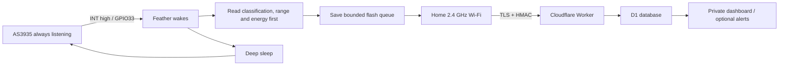

# Design rationale and system limits

## Intended V1

An outdoor, wireless, low-power weather instrument that reports local lightning-like detections and estimated range. The selected board is Adafruit **5400, PCB antenna Feather ESP32 V2**, not the older HUZZAH32 or an ESP32-S3 Feather. The selected sensor is SparkFun **SEN-15441, SPI revision**. No mains, Ethernet, exposed antenna wire or permanently attached charging cable goes outdoors.

## Electrical decisions

The Feather's main `3V` rail stays on in sleep and supplies the AS3935. The switched STEMMA/NeoPixel rail is turned off; using that connector's power would defeat continuous listening. GPIO33 is an RTC-capable input for high-level EXT0 wake; the sketch releases its RTC configuration before using it as a normal input.

SPI uses the actual Feather V2 mapping: SCK=GPIO5, MOSI=GPIO19, MISO=GPIO21. CS=GPIO27 avoids GPIO12's boot strap. Use 3.3 V sensor supply and signals throughout; the bare sensor's broader voltage range does not authorize 5 V into ESP32 GPIOs.

The breakout includes its ferrite antenna, tuning components, local bypass capacitors and a 10k CS pull-up (onboard R8). The two added 100k resistors R1/R2 hold SCK/MOSI low when SPI stops. Keep the optional I²C pull-up jumper open for SPI. There is no additional regulator or battery divider. GPIO35 already monitors battery through the Feather's onboard divider.

## What an interrupt preserves

The AS3935 processes the RF pulse while the ESP32 is asleep. The result is read after wake. Its datasheet specifies at least 2 ms before reading the interrupt register; reading that register clears IRQ. The firmware captures first, then performs slow work. It does **not** reset the AS3935 or clear its statistics on every deep-sleep wake.

This does not mean that every strike is retained indefinitely. There is no host-readable FIFO of complete events. Later activity can replace a result. The sensor itself resolves events only about a second apart, and firmware can be occupied with association, TLS or flash writes. It checks again after uploading and before sleep, but observations during those intervals can coalesce. Detection counts are counts of **captured observations**, not a complete lightning census. Radio transmissions and digital switching can also introduce interference.

Register reads of `0x03` have a side effect even when reading other bits of that register. Do not add a “status poll” of it before capturing a pending result. IRQ with reason `0` is a statistical range update, not a new strike. Persistent noise can leave IRQ high; firmware bounds its drain loop and uses a 60-second timer backoff to avoid a continuous reboot loop. Detection completeness is reduced during backoff.

## Range and energy semantics

The distance value represents a statistical storm-front estimate. Special raw values: `1` means overhead, `63` means out of range; `0` or an unrecognized value is unavailable. The firmware keeps raw codes; the dashboard does not show overhead as a literal 1 km measurement or out-of-range as 63 km. Range updates do not activate the storm indicator.

Energy uses register bits `0x04[7:0]`, `0x05[7:0]`, `0x06[4:0]`: **21 bits**, maximum 2,097,151. Some library comments call it 20-bit; that is inconsistent with the register width. It has no physical units and is not a calibrated bolt strength measurement.

## Cloud and timing

One registered device per Worker deployment. The device signs the exact UTF-8 JSON body with HMAC-SHA256, using the 64-character secret as text on both sides. TLS verifies the server certificate; there is no insecure fallback. D1's `(device_id,seq)` key prevents duplicate records; a fingerprint detects reuse of a sequence with different data.

NVS reserves sequence blocks of 256. RTC RAM preserves the unused part over deep sleep. Power loss skips IDs rather than reusing them. Erasing NVS requires a new device ID or a deliberate migration of the high-water mark.

The RTC clock continues over deep sleep after NTP sync but can drift. Events captured before a usable clock have a null detection time. The cloud records arrival separately and excludes untimed lightning from current storm state. Capture times more than five minutes in the future at arrival are stored as untimed, while retry identity still uses the original fields. This prevents a badly drifting RTC from blocking the entire queue. Old queued strikes keep their old detection times; reconnecting after an outage does not make them current activity. Signed envelopes must have a send time within 5 minutes of the server, limiting replay of captured requests.

The queue holds 128 observations. When full, it discards the oldest and reports a cumulative overflow count. Two alternating checksummed files reduce exposure to a torn write. Filesystem failure is logged and not silently formatted. If no readable queue remains, the node cannot reliably report that failure; the dashboard becomes overdue after its health interval expires. This is a bounded prototype store, not lossless industrial logging; a sudden power loss can still lose the event being committed. Routine filesystem rewrites also wear flash; high-noise locations must be corrected.

The host maintains the one-hour activity window. Its health becomes overdue after 12 hours without a report. “No detections in last hour” is observational, never a prediction of safety. A range trend compares medians in two recent windows and needs at least three observations each; it reports range increasing/decreasing without inventing wind direction or approach velocity.

## Scope of alerting

Notifications are disabled by default. The dashboard does not request permission or send browser notifications. The optional server webhook has a ten-minute cooldown but no delivery outbox or receipt; integrations are future work. See [notification options](notifications.md).

## Mechanical and weather decisions

A 138 × 138 mm, 2 mm thick nonmetallic carrier fits inside the verified 1554R2GY drawing. Corner notches clear the enclosure's mounting structures. Boards and battery occupy separate plan areas, and the two antenna reference points are about 126 mm apart. This spacing is an engineering starting point, not a measured RF isolation specification.

The plastic vent equalizes pressure but does not dry the enclosure or guarantee zero condensation. Preserve the gasket, assemble dry, use a small desiccant packet, and inspect after the first weather cycle. The assembled modified box is **not certified IP68** merely because the box and vent separately have ratings. A dry empty-box spray test precedes electronics installation.

Battery protection handles certain electrical faults, not pouch damage or temperature abuse. The selected battery has no thermistor. V1 charging is indoors with the lid open, dry electronics and room-temperature battery. A continuously unattended, year-round outdoor instrument needs a battery approved for that duty and a temperature-controlled power design; see the upgrade roadmap.

## Design decisions

| Earlier assumption | Decision in this build |
| --- | --- |
| I²C wiring is convenient | Use SparkFun's supported SPI configuration |
| 120 mm box might suffice | Verified deeper 160 mm box and coordinate carrier |
| 6–12 months on a battery | Measure sleep and transaction charge; no promised lifetime |
| Fully sealed box prevents moisture | Vent, dry assembly and inspection; modification requires checks |
| Perfect event preservation across wake | Prompt read, bounded queue, explicit burst/transfer limitations |
| 20-bit energy | Accept the actual 21-bit field |
| Unverified TLS certificate | Verified TLS required; configuration fails closed |
| A compass or two chip energy readings might give direction | Neither is a validated V2 direction design |
